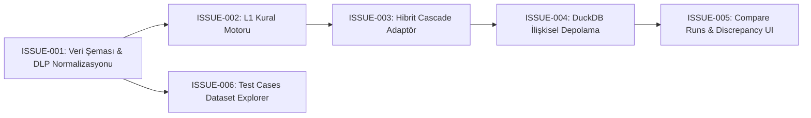

# Faraday Laya Guard: Issue Tracker & Roadmap

Spesifikasyon [SPEC-0002](../specs/hybrid-guard-and-discrepancy-benchmark-spec.md) kapsamındaki dikey dilimler (Vertical Slices / Tracer Bullets):

| Issue ID | Başlık | Engellenen (Blocked by) | Durum |
| :--- | :--- | :--- | :--- |
| **[ISSUE-001](./ISSUE-001-analysis-tier-schema-and-dataset-normalization.md)** | Analysis Tier Şeması ve Gerçek DLP/Gizlilik Veri Normalizasyonu | *None (Hemen başlanabilir)* | ✅ Done |
| **[ISSUE-002](./ISSUE-002-declarative-l1-static-rule-engine-and-adapter.md)** | Bildirimsel L1 Statik Kural Motoru ve Bağımsız Benchmark Adaptörü | [ISSUE-001](./ISSUE-001-analysis-tier-schema-and-dataset-normalization.md) | ✅ Done |
| **[ISSUE-003](./ISSUE-003-fail-fast-cascade-hybrid-engine.md)** | Kademeli Fail-Fast Hibrit Güvenlik Motoru (HybridCascadeAdapter) | [ISSUE-002](./ISSUE-002-declarative-l1-static-rule-engine-and-adapter.md) | ✅ Done |
| **[ISSUE-004](./ISSUE-004-scalable-duckdb-relational-storage.md)** | 10.000+ Ölçekli DuckDB İlişkisel Depolama (run_case_evaluations) | [ISSUE-003](./ISSUE-003-fail-fast-cascade-hybrid-engine.md) | ✅ Done |
| **[ISSUE-005](./ISSUE-005-discrepancy-api-and-compare-runs-ui.md)** | Uyuşmazlık (Discrepancy) API'si ve Web UI "Compare Runs" Görünümü | [ISSUE-004](./ISSUE-004-scalable-duckdb-relational-storage.md) | ✅ Done |
| **[ISSUE-006](./ISSUE-006-test-cases-dataset-explorer.md)** | Test Vaka ve Veri Kümesi Gezgini (Test Cases Dataset Explorer) | *None* | 🟡 In Progress |

---

### Bağımlılık Zinciri:

